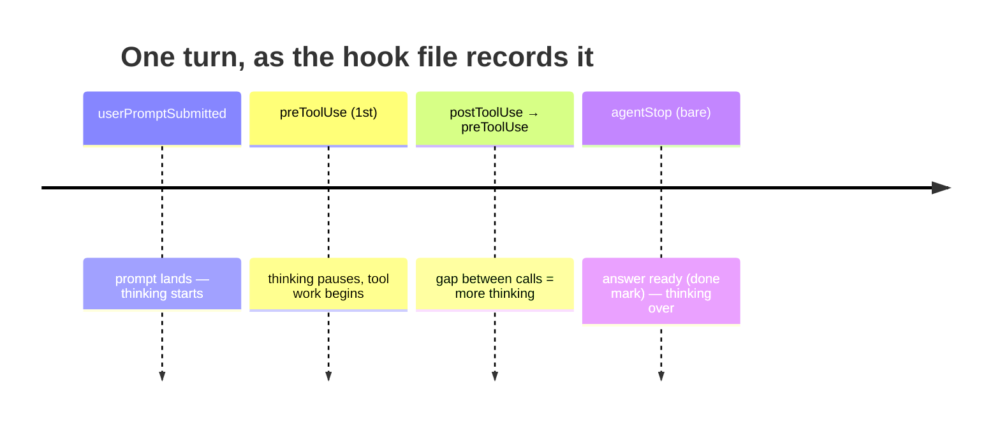

# Thinking-Phase Indicator

**Status:** Proposed — specced, not implemented. Written by the Architect on
2026-11-14 after the design discussion in chat. Nothing here is built yet;
when the user confirms a direction, this spec is the contract for it.

**Requirement:** After a prompt is submitted, the chat shows "Thinking" /
"Analyzing" while the model works without calling a tool. The map shows
nothing in that window — the person cannot see *that* the session is busy,
let alone how long it thinks. The map should show the main loop's activity
between calls.

## The fact that shapes everything

Copilot fires **no hook while it thinks**. The hook system only reports
boundaries: `sessionStart`, `userPromptSubmitted`, `preToolUse`,
`postToolUse` (+ `postToolUseFailure` → `errorOccurred`), `agentStop`,
`errorOccurred`. The phase therefore cannot be *observed* — it must be
**inferred from the gaps** between the events we already get. Those events
bracket it exactly:

## Inference definition

The main loop is *thinking* when, since the most recent
`userPromptSubmitted`:

- no **main-loop** entry is open (`status: 'run'` with no `agentId`), and
- no answer mark has appeared (the bare `agentStop` → `mark: 'done'`).

Every input is already in the `Board` contract: the You row is
`from: 'inbound'`, the answer is `mark: 'done'`, open calls are
`status: 'run'`, subagents carry `agentId`. A subagent's open rows do **not**
count — while a planet works, the main loop may or may not think, and the
indicator tracks the main loop only.

## Options considered

**Option 1 — inferred glow in the draw engine (recommended).**
While the inference condition holds, the core (or the Model station) glows
in its own quiet rhythm — e.g. a slow breathing ring, clearly distinct from
a call pulse. No contract, schema, hook or settings change at all;
`hooks/draw.ts` receives the board and `now` and computes the state from
entries alone. Smallest possible step.

**Option 2 — a synthetic open row on the Model station.**
On `userPromptSubmitted`, `begin()` an entry `station: 'model'`,
`status: 'run'` (label like "denkt…", `uncounted` so the station count stays
honest), finish it at the first `preToolUse` or the `done` mark. The
*duration* becomes visible in the feed, and the row can be relabelled
retrospectively (a gap that saw no further tool call was answer-writing, not
thinking). No type change — `Entry` already supports all of it — but it
blurs the rule that feed rows are real actions, and adds one synthetic row
per turn. Natural upgrade path if durations in the feed prove wanted.

**Option 3 — proxy signal (ADR-004 extension).**
The loopback proxy already reads the token stream; it could report
first-token timing and streaming activity, which is the only way to tell
*thinking* from *writing the answer* in real time. Costs a proxy contract
extension plus a settings surface change — deferred unless the inference
proves too vague in practice.

**Recommendation:** Option 1 now; Option 2 later if feed durations are
wanted; Option 3 only on demonstrated need.

## Known limitation

With options 1–2 the map cannot distinguish thinking from composing the
final answer **while it happens** — Copilot sends no signal between the
last `postToolUse` and `agentStop`. In real time the map can only say
"model active, no call open". The split is knowable retrospectively: if no
further tool call arrived before the `done` mark, the last gap was
answer-writing. Whatever is drawn must never show reasoning *content* —
timing and state only (ADR-002 applies; in fact only figures ever leave the
hook).

## Acceptance criteria (for whichever option is chosen)

- The indicator appears promptly after `userPromptSubmitted`, before any
  tool call fires.
- It disappears at the first main-loop `preToolUse`, re-appears in gaps
  between calls, and ends at the bare `agentStop` (also on an aborted turn).
- A busy subagent alone does not trigger it — its rows carry `agentId` and
  are outside the inference.
- An open background task (`task` set) alone does not suppress it: the main
  loop may think while a task runs.
- No new hook events, no hook event schema change; the installed hook stays
  exactly as fail-safe as it is (ADR-001).
- Existing smoke scripts need no change — they fire tool calls immediately
  after the prompt, so the indicator window is naturally empty there.
