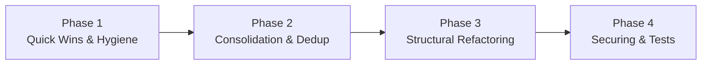

# Cleanup and Quality Plan

Read-only audit of the whole repository after intensive iterative development ("vibe coding").
This file is the only artifact of the audit — no source, test or configuration file was changed.
All line numbers refer to the repository state at audit time; if earlier tasks shift lines,
re-locate the cited symbol instead of the number.

**Baseline at audit time (all green):**

- `cd vscode-extension && npm ci && npm test` — compiles, then 4/4 `node --test` cases pass
- `cd demo && npm ci && npm run typecheck` — clean
- `cd vscode-extension && npm run package` — builds `agentic-orbit-0.2.0.vsix`
- Type system is clean: zero `any`, `@ts-ignore`, or `as unknown as` in the codebase

**How to work through this plan:** land tasks in phase order, one work package per change.
Within a phase, tasks touch disjoint files except where a dependency is noted; land those in the
listed order. Every merged task adds a line to the `Unreleased` section of `CHANGELOG.md` and is
verified with the commands in its *Verification* block. Git work goes through the Version Control
Agent; durable contract changes get a one-line entry in the decision log via the Memory & ADR Agent.

---

## 1. Executive Summary & Architecture Diagnosis

### 1.1 What is in good shape

- **Documented, enforced module boundaries.** `hooks/` is a pure library with no engine or VS Code
  imports (ADR-003); `board.ts` and `classifyCopilot.ts` are VS Code-free; the webview is a
  sandboxed, message-only esbuild bundle (ADR-005, with a regression test guarding it).
- **Privacy and fail-safe contracts hold everywhere:** the hook always exits 0, always answers
  `allow`, and writes names and figures only (ADR-001, ADR-002); the loopback proxy (127.0.0.1,
  default off) is the single network exception and is documented as such (ADR-004).
- **No type-system escapes.** No `any`, no `@ts-ignore`, no double casts; the demo typechecks
  against the same contract file.
- **Deliberate, documented defensive code.** The `catch` blocks in the hook and watcher are
  intentional silence per ADR-001 — they are not swallowed-error smells.
- **Self-healing runtime state** (stale seats are dropped in `seatCrew`), and a focused regression
  suite plus two smoke scripts covering the highest-risk paths.

### 1.2 Pain points, ranked

1. **Parked-feature and terminal-era dead code (~15% of `hooks/` surface is unreachable):**
   three dead `Setup` options, two dead exports in `classify.ts`, two in `feed.ts`, a parked
   background-task cluster in `board.ts` plus its contract field, a re-export hub (`map.ts`),
   12 dead i18n keys × 7 languages, and four dead `Board` contract fields.
2. **A real behavior bug around settings:** the panel caches its `Setup` once at construction, so
   setting changes never reach an open map, while the extension host rebuilds `Setup` up to three
   times per event. Config changes only restart the watcher.
3. **A real correctness bug in the proxy:** request bodies over 8 MB are silently *truncated*
   and forwarded, corrupting large requests.
4. **God-files:** `hooks/draw.ts` (634 lines), `demo/engine.ts` (450 lines, five hand-written
   scenarios), `extension.ts` (295 lines mixing config, event handling, hook install, proxy, activation).
5. **Duplication across the panel and the demo:** `ZOOMS` twice, the language list twice, the
   "now" meter twice with divergent model-shortening rules, and the demo re-implements the host's
   event handling minus name parking — so the README's "same event handling" claim is not yet true.
6. **CI never runs the tests:** `check.yml` compiles only; the demo is never type-checked in CI.
7. **Hygiene and naming relics:** an unignored `.kiro/` tool-state directory and stray artifacts,
   the old `LotMapPanel` class name, "mod" wording in comments, German user-facing output in two
   scripts, a wrong security-advisory URL in the issue template, shipped README documenting 11 of
   18 settings.

Not debt, verified and deliberately left alone: the byte-identical `.github/hooks/agentic-orbit-hook.js`
is the expected self-hosting copy the install command writes (gitignored), the "Nothing here touches
the engine" header sentence is the ADR-003 wording, and `demo/main.ts` non-null assertions against
its own static HTML are acceptable workshop code.

### 1.3 Architecture verdict

No boundary *violations* were found — no UI-to-data shortcuts, no engine imports in `hooks/`, no
circular dependencies. The drift is *inside* the sanctioned modules: files grew until they mix
layers (event application, rendering, and wiring in `extension.ts`; geometry, effects, crew state
and scene assembly in `draw.ts`). The fix is extraction inside the existing boundaries, not
re-architecture. Two contracts change (dead fields removed); nothing is added speculatively.

### 1.4 Estimated effort

| Phase | Content | Risk | Effort |
|---|---|---|---|
| 1 | Quick wins & hygiene (12 tasks) | low — mostly deletions | ~1 day |
| 2 | Consolidation & deduplication (5 tasks) | low–medium | ~1–1.5 days |
| 3 | Structural refactoring (4 tasks) | medium — visual/behavior-preserving | ~2–3 days |
| 4 | Securing & tests (4 tasks) | low | ~1–1.5 days |

Total: roughly 5–7 focused days, landable one task per change without merge conflicts.

---

## 2. Prioritized Phases (Roadmap)



- **Phase 1** removes dead code and cruft. Deleting first shrinks every later diff and prevents
  refactoring code that would be deleted anyway.
- **Phase 2** merges the duplicated logic (zoom ladder, language list, now-line, Setup lifecycle)
  and moves data out of `extension.ts`.
- **Phase 3** splits the three god-files. Task 3.1 (shared event applier) must land before 3.3 and
  3.4; 2.5 must land before 3.4.
- **Phase 4** fixes the proxy bug, makes CI run the tests, closes the test gaps that Phases 1–3
  exposed, and reconciles documentation with reality.

Sequencing inside the phases is noted per task; phases land strictly in order.

---

## 3. Phase 1 — Quick Wins & Hygiene

Low-risk deletions and text fixes. Every task ends with the full gate:
`cd vscode-extension && npm test` and `cd demo && npm run typecheck`.

### - [x] Task 1.1: Purge repository cruft and close the `.kiro/` ignore gap

**Problem:** The working tree carries stale, regenerable or foreign artifacts: a root `.DS_Store`,
a stale packaged `vscode-extension/agentic-orbit-0.1.0.vsix` (current version is 0.2.0), build
outputs (`vscode-extension/out/`, `demo/bundle.js`, both regenerable), and an unignored `.kiro/`
tool-state directory (`.kiro/command-mesh/state.json`, `.kiro/command-mesh/bridge.lock`) that does
not belong in version control if tracked.

**Affected files:**
- `.DS_Store` (repo root, on disk)
- `vscode-extension/agentic-orbit-0.1.0.vsix`
- `vscode-extension/out/`, `demo/bundle.js` (regenerable build outputs)
- `.kiro/` (directory)
- `.gitignore` (add an entry)

**Target state / Umsetzung:**
1. Add `.kiro/` to `.gitignore` (the file already ignores `.DS_Store`, `*.vsix` under
   `vscode-extension/`, `demo/bundle.js` and `vscode-extension/out/` — extend the same style).
2. Delete the artifacts with plain filesystem operations. Because only the Version Control Agent
   may inspect or change Git state, hand it this step: *check whether `.kiro/` or root
   `.DS_Store` are tracked; if tracked, remove them from the index; verify the working tree is
   clean afterwards.*
3. Keep the current `agentic-orbit-0.2.0.vsix` if intentionally kept as a release artifact;
   otherwise delete both vsix files — `npm run package` recreates them.

**Verification:** `git status` shows no `.kiro/` or `.DS_Store` noise (via Version Control Agent);
`cd vscode-extension && npm test` still passes (it recompiles `out/`); `demo` page still loads
(rebuild `demo/bundle.js` via its build script if it was deleted).

### - [x] Task 1.2: Delete the dead terminal-era options from `hooks/setup.ts`

**Problem:** `Setup` still carries three options from the retired terminal renderer with zero
consumers anywhere in the repo (verified by grep): `textSize`, `terminalView`, `cellShape`, plus
the `CELL_SHAPE` table and `cellShapeFrom` resolver. Dead options inflate the shared contract and
mislead readers about what is configurable.

**Affected files:**
- `hooks/setup.ts:50–57` (fields `textSize`:52, `terminalView`:54, `cellShape`:56 with comments),
  `:60` (`CELL_SHAPE`), `:62–66` (`cellShapeFrom`), `:91–93` (assignments in `setupFrom`)

**Target state:** Remove all five members and their assignments; `Setup` keeps only the options the
map actually consumes. Do not renumber other fields. No other file references these names
(verified). Contract note: `Setup` is shared — no consumer change needed since nothing reads them.

**Verification:** `grep -rn "textSize\|terminalView\|cellShape\|CELL_SHAPE" .` returns nothing;
`cd vscode-extension && npm test` and `cd demo && npm run typecheck` pass.

### - [x] Task 1.3: Remove dead exports in `hooks/classify.ts` and `hooks/feed.ts`

**Problem:** Two exports in each file have no callers anywhere (verified by grep over all
consumers, including tests and demo): `firstLine` and `memoryIds` in `classify.ts`, and `taskOf`
plus `taskNotice` in `feed.ts` (the latter two are only re-exported through `hooks/map.ts`, which
itself has one consumer — see Task 1.5).

**Affected files:**
- `hooks/classify.ts:260–263` (`firstLine`), `:266–268` (`memoryIds`)
- `hooks/feed.ts:35–46` (`taskOf`), `:47–53` (`taskNotice`)

**Target state:** Delete the four functions. When deleting `taskOf`/`taskNotice`, also drop their
re-exports from `hooks/map.ts` (lines listing them) — but *keep* `shortModel` there until Task 1.5
removes the file wholesale; if Tasks 1.3 and 1.5 land together, skip the intermediate step.

**Verification:** `cd vscode-extension && npm test`, `cd demo && npm run typecheck` pass;
`grep -rn "firstLine\|memoryIds\|taskOf\|taskNotice"` returns nothing.

### - [x] Task 1.4: Remove the parked background-task cluster from `board.ts` and the contract

**Problem:** `board.ts` contains a parked "background task" feature: `background()` and `settle()`
are never called by anything, and `Entry.task` is therefore never written at runtime — but it is
still read in three places, so the contract advertises state that can never occur. This is the
largest single chunk of unreachable engine code.

**Affected files:**
- `vscode-extension/src/board.ts:93–96` (`background()`), `:99–105` (`settle()`),
  `:27` (`task` clause in `kept()`), `:100` (retire sweep clause), `:115` (`agentDone` clause
  `x.task === agentId`)
- `types/index.d.ts:20` (`Entry.task`)

**Target state:** Delete `background()` and `settle()` and every `Entry.task` read; remove
`task?: string` from `Entry` in the shared contract. The park/claim/unpark name logic
(`parkedNames`, see Task 3.1) is a *different, live* feature — do not touch it. After landing,
ask the Memory & ADR Agent for a one-line decision-log entry recording that the unused
background-task experiment was dropped from the contract.

**Verification:** `grep -rn "Entry.task\|\.task\b" vscode-extension/src demo hooks types` shows no
stale reads (mind `taskOf` false positives if Task 1.3 has not landed); `cd vscode-extension &&
npm test` (the board-transition test covers `kept()`/`agentDone()` behavior) and
`cd demo && npm run typecheck` pass.

### - [x] Task 1.5: Retire the `hooks/map.ts` re-export hub

**Problem:** `hooks/map.ts` (17 lines) is a leftover indirection layer from the terminal project:
it only re-exports names from `classify.ts`/`feed.ts`. Its sole consumer is the demo engine, which
could import directly. Extra indirection obscures where symbols live.

**Affected files:**
- `hooks/map.ts` (whole file — delete)
- `demo/engine.ts:6` (`import { shortModel } from '../hooks/map'`)
- `vscode-extension/tsconfig.json` (include entry `"../hooks/map.ts"`)
- `demo/tsconfig.json` (include entry `"../hooks/map.ts"`)

**Target state:** Change `demo/engine.ts:6` to import `shortModel` from `'../hooks/classify'`
(verify the defining module; today `shortModel` lives in `classify.ts`). Delete `hooks/map.ts` and
its entry from both tsconfig include lists. The stale compiled `out/hooks/map.js` disappears on the
next build (build output is regenerated).

**Verification:** `cd vscode-extension && npm test` and `cd demo && npm run typecheck` pass;
`grep -rn "hooks/map"` returns nothing.

### - [x] Task 1.6: Delete the 12 dead i18n keys from all seven languages

**Problem:** `Strings` carries twelve keys with zero readers (verified — earlier `t.command` grep
hits were `input.command` false positives): `command`, `opened`, `cannotOpen`, `compacting`,
`addedContext`, `addedMemory`, `toMessage`, `atStart`, `records`, `stopped`, `askedPermission`,
`checkBefore`. They date from terminal-era panels that no longer exist. Their bulk is multiplied
by seven language tables. The file header also says the strings back `plugin.json`, but the
manifest is `package.json`.

**Affected files:**
- `hooks/text.ts:8–29` (type block: the twelve keys listed above)
- per-language table entries: en `:49, 51–52, 74–76, 78–82`; ru `:127–135`; es `:180–188`;
  fr `:233–241`; de `:286–294`; it `:339–347`; pt `:393–401`
- `hooks/text.ts:2` (header comment "plugin.json")

**Target state:** Remove the twelve keys from the `Strings` type and from **all seven** tables
(en, ru, es, fr, de, it, pt) so the tables still satisfy `Strings`. Fix the header comment to
`package.json`. Leave `stringsFor` (:422) and `LANGUAGES` (:425) untouched. The compiler is the
safety net: because every table is typed `Strings`, a missed table entry fails typecheck, and a
still-read key fails immediately.

**Verification:** `cd vscode-extension && npm test` and `cd demo && npm run typecheck` pass;
switch the demo to each language — no new blank labels (a missing key would render as the raw
placeholder).

### - [x] Task 1.7: Remove the dead `Board` contract fields `pushed`, `open`, `minimized`, `zoom`

**Problem:** Four `Board` fields are never written by any code (verified by grep over
`board.*` writes — the panel keeps its *own* `minimized`/`zoom` instance fields plus globalState,
and the demo writes its own view-state object, neither goes through `Board`). `draw.ts` reads
`pushed` (:361) to render a "pushed/asked" count that can therefore only ever show the fallback.
Dead contract fields suggest behavior that does not exist.

**Affected files:**
- `types/index.d.ts:31` (`pushed`), `:42` (`open`), `:44` (`minimized`), `:46` (`zoom`)
- `hooks/draw.ts:361–364` (`pushed`/`asked` label rendering)

**Target state:** Delete the four fields from `Board`. In `draw.ts:361–364`, drop the `pushed`
variable and its conditional `tspan` branch; render the (still live) `asked` count plainly.
Record the contract change with a one-line decision-log entry via the Memory & ADR Agent.

**Verification:** `cd vscode-extension && npm test` (the `projectView` test renders a board and
catches signature drift) and `cd demo && npm run typecheck` pass; the legend count on the demo map
still shows the permission-asked number.

### - [x] Task 1.8: Remove the never-written `HookEvent` fields `command` and `promptTokens`

**Problem:** The `HookEvent` type declares fields the hook never writes and no reader reads
(verified against the hook's `out` object). The hook *does* write `v`, `ts`, `session` and
`status` (`res/agentic-orbit-hook.js:36–55`, `:85`) — those stay, even though the extension does
not read them, because they document the wire format. `command` and `promptTokens` document
nothing real and mislead.

**Affected files:**
- `vscode-extension/src/hookWatcher.ts:21` (`command`), `:25` (`promptTokens`) within the
  `HookEvent` type at `:9–27`

**Target state:** Delete the two fields from the type. Do not touch the four wire-format fields.
Note for the implementer: `demo/engine.ts` defines its own `FakeEvent` with `commandName` — that is
a different, live field.

**Verification:** `cd vscode-extension && npm test` passes; `grep -n "promptTokens" vscode-extension/src/hookWatcher.ts` returns nothing (the demo's fake telemetry `promptTokens` is unrelated and stays).

### - [x] Task 1.9: Fix naming and wording relics; repair the issue-template security URL

**Problem:** The class is still called `LotMapPanel` (the project's terminal predecessor was
"lot-map"); several comments and one privacy doc say "mod" where they mean "extension"; and
`.github/ISSUE_TEMPLATE/config.yml` points the security advisory link at the old repository
(`alexeyw/lot-map`) instead of this one — a real, user-facing wrong link. (The hook's own
"the mod" phrasing at `res/agentic-orbit-hook.js:5` is quoted verbatim in docs; align it too.)

**Affected files:**
- `vscode-extension/src/panel.ts:13` (`export class LotMapPanel`)
- `vscode-extension/src/extension.ts:15, 17, 267` (import, field type, instantiation)
- `hooks/setup.ts:1, 30` ("mod" comments); `vscode-extension/src/classifyCopilot.ts:2, 43`
  ("mod" comments); `vscode-extension/src/panel.ts:1` (header comment)
- `PRIVACY.md:7` ("a mod that follows tool calls")
- `.github/ISSUE_TEMPLATE/config.yml:4` (`url: https://github.com/alexeyw/lot-map/...`)

**Target state:**
1. Rename `LotMapPanel` → `AgenticOrbitPanel` in the three `extension.ts` sites and the
   `panel.ts` declaration. Pure rename, no signature change.
2. Replace "the mod's"/"the mod" with "the extension's"/"the extension" in the listed comments
   and `PRIVACY.md:7`. Keep the ADR-003 sentence "Nothing here touches the engine" — only the
   "mod" word is stale.
3. Fix `config.yml:4` to `https://github.com/schrauth/agentic-orbit/security/advisories/new`
   (matches `SECURITY.md`).

**Verification:** `grep -rn "LotMapPanel\|\bmod\b"` over `src/ hooks/ PRIVACY.md` returns nothing
new; `cd vscode-extension && npm test` passes; the GitHub issue-template link resolves.

### - [x] Task 1.10: Make the helper scripts English and consistent

**Problem:** Project rule: all writing is English, including UI text. Both helper scripts print
German user-facing output. Additionally, `smoke-test.sh` resolves the events file itself instead
of honoring `AGENTIC_ORBIT_EVENTS_FILE` (which `subagent-storm.sh:~22` and the hook both honor),
so the two scripts disagree on where events land.

**Affected files:**
- `scripts/smoke-test.sh` (German echoes; events-file resolution around `:20–25`)
- `scripts/subagent-storm.sh` (German echoes)

**Target state:** Translate all user-facing output in both scripts to English (keep the shell
logic). In `smoke-test.sh`, resolve the events file exactly like the hook does: prefer
`AGENTIC_ORBIT_EVENTS_FILE`, else the tmpdir hash path — mirroring `res/agentic-orbit-hook.js:22–31`.

**Verification:** `bash -n scripts/*.sh` passes; run `AGENTIC_ORBIT_EVENTS_FILE=$(mktemp -u).jsonl
bash scripts/smoke-test.sh` and confirm it reads/writes that file (with the hook installed).

### - [x] Task 1.11: Normalize the tsconfig include lists

**Problem:** Both tsconfigs enumerate files by hand. The `vscode-extension` list omits
`hooks/view.ts` (it compiles only because a `src/` file imports it — an implicit dependency that
breaks silently if the import graph changes), and both lists carry `../hooks/map.ts` until Task 1.5
removes it. Hand-maintained file lists are drift-prone.

**Affected files:**
- `vscode-extension/tsconfig.json` (include list)
- `demo/tsconfig.json` (include list)

**Target state:** Replace the per-file lists with directory includes that mean the same thing:
`vscode-extension/tsconfig.json` → `["src", "../hooks", "../types/index.d.ts"]`;
`demo/tsconfig.json` → `["*.ts", "../hooks", "../types/index.d.ts",
"../vscode-extension/src/board.ts", "../vscode-extension/src/classifyCopilot.ts"]`.
Keep `rootDir`/`outDir` as-is. Land after Task 1.5 (so `map.ts` is already gone).

**Verification:** `cd vscode-extension && npm test` and `cd demo && npm run typecheck` pass;
`ls vscode-extension/out/hooks/*.js` shows the same set of modules as before (now including
`view.js` explicitly rather than implicitly).

### - [x] Task 1.12: Micro-hygiene sweep

**Problem:** Three tiny inconsistencies: a stray space inside a string comparison
(`proxy.ts:139`, `if (msg.model === '' )` — harmless but sloppy in a security-relevant file);
`hookWatcher.ts:58` uses `let read` where nothing reassigns it; `webview/render.ts:49` uses a
non-null assertion on `document.getElementById('counts')` while its sibling lookups
(`:13–16`) are null-checked with an early return — one inconsistent pattern in the same function.

**Affected files:**
- `vscode-extension/src/proxy.ts:139`
- `vscode-extension/src/hookWatcher.ts:58`
- `vscode-extension/src/webview/render.ts:49` (and `:7` module-level `let expanded` — keep, it
  is the intentional singleton state of the webview)

**Target state:** Fix the space; change `let read` to `const read`; make the `counts` lookup
follow the null-checked early-return pattern of its siblings. Do not restructure anything else.

**Verification:** `cd vscode-extension && npm test` passes (the bundle-guard test re-builds and
checks the webview); open the panel — counts row still renders.

---

## 4. Phase 2 — Consolidation & Deduplication

### - [x] Task 2.1: Single source the zoom ladder (`ZOOMS`)

**Problem:** The pixel-width ladder `[180, 220, 260, 310, 370, 440, 530, 570, 620, 660]` is
duplicated verbatim in the panel and the demo engine. A future zoom change would have to be made
twice and could silently diverge (the demo exists to preview exactly such changes).

**Affected files:**
- `vscode-extension/src/panel.ts:11`
- `demo/engine.ts:35`
- `hooks/view.ts` (target home)

**Target state:** Move the ladder to `hooks/view.ts` as
`export const ZOOMS: readonly number[] = [180, 220, 260, 310, 370, 440, 530, 570, 620, 660]`
(`hooks/view.ts` is the shared, VS Code-free view module both consumers already import).
`panel.ts` imports it; `demo/engine.ts` drops its copy and `demo/main.ts` imports `ZOOMS` from the
engine's re-export or directly from `../hooks/view` (pick one path; keep the demo's `zoom`
state index semantics unchanged).

**Verification:** `cd vscode-extension && npm test` (zoom math at `panel.ts:71–72` covered by
compilation) and `cd demo && npm run typecheck` pass; the demo zoom buttons step through the same
ten widths as before.

### - [x] Task 2.2: Single source the language list in the demo

**Problem:** `demo/main.ts:113` hardcodes `['en','de','es','fr','it','pt','ru']` while the panel
uses `LANGUAGES` from `hooks/text.ts:425`. Adding a language would update one list and miss the
other.

**Affected files:**
- `demo/main.ts:113`
- `hooks/text.ts:425` (`LANGUAGES`, reference only)

**Target state:** `demo/main.ts` imports `LANGUAGES` from `'../hooks/text'` (as `panel.ts:68`
already does) and builds its selector from it. No change to `text.ts`.

**Verification:** `cd demo && npm run typecheck` passes; the demo language selector still lists
all seven languages in the same order.

### - [x] Task 2.3: Fix the `Setup` lifecycle (open panels must react to settings changes)

**Problem:** Behavior bug. The panel computes `Setup` **once** in its constructor
(`panel.ts:15`, `:29`) — changing `agenticOrbit.language`, `theme`, `layout`, `pace`, `coreName`,
`background`, `colors` or any `memory*` setting never reaches an open map. Meanwhile the extension
host builds a fresh `Setup` per event (`extension.ts:63–66` `classifyEvent`) *and* a second one per
`t()` call (`:55`), and `onDidChangeConfiguration` (`:285–287`) only restarts the watcher. One
feature, three lifecycles.

**Affected files:**
- `vscode-extension/src/panel.ts:15` (`private readonly setup: Setup`), `:29` (constructor
  assignment), `:76–78` (`send()` uses the cached field)
- `vscode-extension/src/extension.ts:55` (`t()` builds its own Setup), `:63–66`
  (`classifyEvent` builds its own), `:285–287` (config-change handler)

**Target state:**
1. `panel.ts`: delete the cached field; in `send()` compute
   `const setup = setupFrom(this.options())` (the constructor already receives the `options`
   provider — reuse it). Per-send construction is trivially cheap (string parsing).
2. `extension.ts`: build one `Setup` per hook event and pass it into both `t(key, setup)` and
   `classifyEvent(e, setup)` (change both signatures to accept it); delete the hidden
   per-call rebuilds.
3. `extension.ts:285–287`: on an `agenticOrbit` configuration change, additionally poke the open
   panel (e.g. a small `refresh()` on the panel that re-runs `send()`), so a live map switches
   language/theme immediately. Keep the watcher restart as-is.

**Verification:** Manual: open the map, change `agenticOrbit.language` → labels switch without
reopening the panel; change `memoryPaths` → memory row disappears. `cd vscode-extension && npm
test` passes.

### - [x] Task 2.4: Unify the now-line meter construction

**Problem:** `hooks/view.ts:55–61` rebuilds the exact meter string that `hooks/feed.ts`'s
`nowParts` (`:56–66`) already produces — but with a *divergent* model-shortening rule
(`view.ts:12` `shortMeterModel`, a blind 14-character cut, vs the family-aware `shortModel` used
everywhere else). Two implementations of one string, one of them subtly wrong. `describeNow`
(`feed.ts:68–75`) overlaps the same data again for the `alt` text.

**Affected files:**
- `hooks/view.ts:12` (`shortMeterModel`), `:55–61` (local meter build), `:66` (nowline assembly)
- `hooks/feed.ts:56–66` (`nowParts`), `:68–75` (`describeNow`)

**Target state:** `view.ts` consumes `nowParts(...).meter` directly and renders it unchanged;
delete `shortMeterModel` and the local rebuild. If `describeNow` becomes redundant after that,
fold its title glue into `nowParts` and keep the rendered nowline and `alt` text byte-identical
(today's output is correct; this task must not change pixels). Do not keep a second
model-shortening helper.

**Verification:** `cd vscode-extension && npm test` (the `projectView` test asserts feed-row
content) and `cd demo && npm run typecheck` pass; visual check on the demo — nowline identical
before/after.

### - [x] Task 2.5: Move the hooks manifest out of `extension.ts` into named, testable data

**Problem:** `installHooks` builds the entire `.github/hooks/hooks.json` object as an inline JSON
literal inside `extension.ts:213–235`. The event matcher list — the most contract-like data in the
extension, and the piece that must track Copilot's hook events — is untestable and buried inside a
290-line wiring file.

**Affected files:**
- `vscode-extension/src/extension.ts:204–240` (`installHooks`), `:213–235` (inline manifest)
- new `vscode-extension/src/hookManifest.ts`

**Target state:** New module `hookManifest.ts` exporting, in the project's plain style:

```ts
export const HOOK_EVENTS = ['preToolUse', 'postToolUse', /* … */] as const
export function hookJson(hookTarget: string, eventsFile: string): string
```

`installHooks` shrinks to: compute paths, copy `res/agentic-orbit-hook.js`, write
`hookJson(...)`. Add a focused unit test asserting every entry of `HOOK_EVENTS` appears exactly
once in `hookJson(...)` output and that the JSON parses. Keep the generated file byte-identical
(key order, indentation) — dogfood workspaces diff it against their installed copy.

**Verification:** `cd vscode-extension && npm test` passes including the new case; run
`Agentic Orbit: Install Workspace Hooks` in a scratch workspace and diff `.github/hooks/hooks.json`
against the previous generated file — identical.

---

## 5. Phase 3 — Structural Refactoring

Behavior- and pixel-preserving splits inside the existing module boundaries (ADR-003: `hooks/`
stays engine- and VS Code-free; the webview stays sandboxed and message-only).

### - [x] Task 3.1: Extract the shared event applier (extension host and demo converge)

**Problem:** `extension.ts:82–174` (`onHookEvent` plus the `parkedNames` helpers at `:66–80`) and
`demo/engine.ts:53–138` (`FakeSession.apply`) implement the *same* event → board translation twice —
the demo copy omits name parking entirely, so the README's claim that the demo "replays the same
event handling the extension host performs" (`README.md:231`) is not true today, and every future
event rule must be written twice or the demo drifts.

**Affected files:**
- new `vscode-extension/src/eventApplier.ts`
- `vscode-extension/src/extension.ts:30, 66–80, 82–174`
- `demo/engine.ts:43–138`
- `README.md:231` (verify/adjust the claim afterwards)

**Target state:** New VS Code-free module (imports only `board.ts`, `classifyCopilot.ts`,
`hooks/*` and `types` — no `vscode`, no engine, per ADR-003):

```ts
export type ApplierState = {
  board: Board
  open: Map<string, string>      // callId → label, matching today's semantics
  parked: Map<string, string>    // callId → parked label (parkedNames moves here)
  lastModel?: string
}
export function emptyState(): ApplierState
export function applyHookEvent(s: ApplierState, e: HookEvent, setup: Setup, now: number): void
```

`extension.ts` keeps only thin wiring: watcher → `applyHookEvent` → publish to panel; its module-level
`parkedNames` map (`:30`) moves into the state. `FakeSession.apply` delegates to the same function —
its fake clock (`base + at`) stays in the demo. After this, the demo exercises name parking too, and
`README.md:231` is accurate without hedging. The `parkedNames` semantics must be preserved exactly:
park on launch, oldest-first claim, unpark on failed launch, clear on turn/session end (see
`extension.ts:69–78, 88, 105, 118, 146`).

**Verification:** Differential check — run the demo's "Subagent storm" scenario before and after;
planet names, rows and counts identical (parking only adds names where the demo previously showed
fallbacks — verify that *added* names are correct parked names, not changed existing ones).
`cd vscode-extension && npm test`, `cd demo && npm run typecheck`, and `bash scripts/subagent-storm.sh`
all pass. This task unblocks Task 3.3, 3.4 and the parked-names tests in 4.3.

### - [x] Task 3.2: Split `hooks/draw.ts` into a module behind an unchanged facade

**Problem:** `hooks/draw.ts` is a 634-line god-file mixing five responsibilities: geometry
primitives, fade/pulse/ripple/beam effects, mutable crew-seat state, trail routing, and scene
assembly. Any map tweak collides with everything else in one file.

**Affected files:**
- `hooks/draw.ts` (whole file — structure: constants `:14–16, 38–59`; fades `:77–90`;
  `seats` Map `:110`, `hueHandouts` `:112`, `Seat`/`seatCrew` `:116–161`; `pulse`:163, `ripple`:181,
  `beam`:190, `orbitBeam`:200; `routeOf` `:243–257`, `isThinking` `:259`, `trail` `:269`;
  `station` `:300`; `drawMap` `:385–630` with legend `:553–555`, core `:600–602`;
  `escapeXml` `:632`)
- new `hooks/draw/` modules

**Target state:** Split into sibling modules under `hooks/draw/`:
- `geometry.ts` — `Point`, `ring`, `edge`, `aside`, `leg` (`:91–99, 232–242`) and the pure
  layout constants they need
- `effects.ts` — `fadeAt`, `agentFadeGroup`, `pulse`, `ripple`, `beam`, `orbitBeam`
- `crew.ts` — the **only** owner of the mutable module state (`seats` `:110`,
  `hueHandouts` `:112`), plus `Seat` and `seatCrew`
- `trail.ts` — `routeOf`, `isThinking`, `trail`
- `scene.ts` — `station`, `drawMap`, legend, core, `escapeXml`

Keep `hooks/draw.ts` as a facade that re-exports the public surface unchanged:
`drawMap`, `MAP_WIDTH`, `MAP_ASPECT`, `AGENT_HOLD_MS`, `AGENT_FADE_MS`, `TRAIL_HOLD_MS`,
`TRAIL_FADE_MS`, `routeOf`. No consumer changes (`board.ts:6`, `view.ts:3`, and the demo import
through them). Constraints: `hooks/draw/*` stays pure and engine-free (ADR-003); the seat/hue
module state must live in exactly one module (`crew.ts`) — do not duplicate the Maps; the
self-healing of stale seats must be preserved. This is a pure move-and-re-export: no logic edits.

**Verification:** `cd vscode-extension && npm test` (the `projectView` test renders the SVG and
catches surface drift) and `cd demo && npm run typecheck` pass; pixel check — render all five demo
scenarios before and after and compare the SVG markup (the demo's board-copy button plus fixed
timestamps make this a diffable string comparison); identical output.

### - [x] Task 3.3: Split the demo scenarios out of `demo/engine.ts`

**Problem:** `demo/engine.ts` is 450 lines, of which ~290 (`:158–444`) are five hand-written
scenarios (`calmTurn`:158, `subagentStorm`:183, `subagentProject`:253, `errorsAndRefusals`:391,
`contextFillsUp`:417, registry `SCENARIOS`:445). Scenarios are content; the engine is machinery;
they change on different rhythms.

**Affected files:**
- `demo/engine.ts:158–445`
- new `demo/scenarios.ts`
- `demo/main.ts:2` (imports `SCENARIOS` from `'./engine'`)

**Target state:** Move the five scenario builders and `SCENARIOS` to `demo/scenarios.ts`
(exporting `Scenario`, `Step` if the demo types them there today — otherwise keep the type
exports in `engine.ts` and import them). `engine.ts` keeps `FakeSession`, `demoSetup` and re-exports
`SCENARIOS` for `main.ts`, or `main.ts` imports from `'./scenarios'` directly (pick the direct
import; one fewer indirection). Land after Task 3.1, since the scenarios' `Step` shape is unaffected
but the engine's apply path changes there.

**Verification:** `cd demo && npm run typecheck` passes; all five scenarios still run and look
identical in the browser.

### - [x] Task 3.4: Slim `extension.ts` to activation wiring

**Problem:** After Tasks 2.3, 2.5 and 3.1, `extension.ts` still mixes four concerns in one file:
config reading (`:33–54`), hook installation (`:204–240`), the proxy command (`:242–259`), and
activation. The file is the extension's front door; it should read as a table of contents.

**Affected files:**
- `vscode-extension/src/extension.ts` (whole file)
- new `vscode-extension/src/config.ts`, `src/installHooks.ts`, `src/proxyCommand.ts`
- existing `src/eventApplier.ts` (from 3.1), `src/hookManifest.ts` (from 2.5)

**Target state:** Move each concern into its named module with the same signatures the tasks
above produced: `config.ts` (`config()`, `t()` taking the shared per-event `Setup` from Task 2.3),
`installHooks.ts` (using `hookManifest.ts`), `proxyCommand.ts` (`startProxyCommand` plus its
telemetry wiring). `extension.ts` retains only: `activate` (register the three commands, start
watcher, wire config-change, conditional proxy start), the disposables list, and module-level
panel/board state — target ≤ ~120 lines. Do not change any command id or setting name.
Land last in Phase 3.

**Verification:** `cd vscode-extension && npm test` passes; F5 the extension and exercise all three
commands (`Show Map`, `Install Workspace Hooks`, `Start Proxy`) plus a settings change with an open
map — everything still works.

---

## 6. Phase 4 — Securing & Tests

### - [x] Task 4.1: Fix the proxy's silent body truncation over 8 MB

**Problem:** Correctness bug in a security- and integrity-relevant component. `proxy.ts:93–96`
counts `bodySize` but guards `body.push` with `bodySize <= 8 * 1024 * 1024`: for a request larger
than 8 MB the tail chunks are dropped, and the **truncated** buffer is still forwarded upstream —
a corrupted request sent with a correct-looking `Content-Length`, silently. No error, no log.

**Affected files:**
- `vscode-extension/src/proxy.ts:93–96` (cap logic), surrounding buffer/forward path
  (`:100–144`), `pipe()` `:146–160`

**Target state:** Remove the truncation hazard. Simplest correct behavior: buffer the full body
(no cap) and forward it byte-identical — the proxy already buffers fully below the cap, a >8 MB
prompt is a legitimate on-prem edge case, and the operator's own request bounds memory. Keep the
token estimate (`estimateTokens` `:15–45`) and all existing guards (loopback binding, model
allow-list) untouched. Add a brief comment stating bodies are buffered whole, deliberately.

**Verification:** New `node --test` case in `vscode-extension/test/`: spin up a local
`http.createServer` as fake upstream, point the proxy at it, send a >8 MB body (e.g. 9 MB of
`'a'`), assert the upstream receives exactly 9 MB and the request succeeds end-to-end. Full
`npm test` passes; manual: proxy enabled, submit an oversized prompt to a local model, no
corruption.

### - [x] Task 4.2: Make CI run the tests and the demo typecheck

**Problem:** `.github/workflows/check.yml` runs `npm ci` + `npm run compile` only
(Build step, `:26–29`, node 22). The four regression tests and the demo typecheck — the two
gates this whole plan relies on — never run in CI, so a broken test or a demo/contract drift
merges silently. `CONTRIBUTING.md` requires `npm ci && npm test` per PR; CI checks less than
the contribution rule demands.

**Affected files:**
- `.github/workflows/check.yml:26–29`

**Target state:** Change the build step to `npm ci && npm test` (the test script already compiles
first). Add a second step (or job) `cd demo && npm ci && npm run typecheck`. Keep node 22 and the
existing trigger/filter configuration.

**Verification:** The workflow goes green on the next PR; the run log shows `node --test`
executing 4+ cases and the demo typecheck completing.

### - [x] Task 4.3: Close the test gaps on the critical paths

**Problem:** The suite covers shell classification, board transitions, the view projection and
the webview bundle guard — but not the paths this plan moved or fixed: the Copilot tool mapping,
event parsing, name parking (until 3.1 not even shared), row folding, trail routing, and the
proxy. These are exactly the behaviors a future refactor could silently break.

**Affected files:**
- `vscode-extension/test/quality.test.cjs` (or sibling `*.test.cjs` files)
- subjects: `src/classifyCopilot.ts:40–150`, `src/hookWatcher.ts:29–50`, `src/eventApplier.ts`
  (post-3.1), `hooks/feed.ts:14–33`, `hooks/draw.ts` facade `routeOf` (post-3.2), `src/proxy.ts`

**Target state:** Add focused `node --test` cases, in the existing CJS style, each asserting
behavior that fails without the feature:
1. `classifyCopilot` mapping: file tools → files station, `run_in_terminal` → shell,
   `task` → agents, `run_skill` → skills, `fetch_webpage`/`web_search` → web,
   `mcp__memory__get` → memory (via `memoryServers`), `mcp__other__x` → the web/memory rule,
   unknown tools → model fallback; label precedence (description over name).
2. `parseEvents` + `eventsFileFor` (`hookWatcher.ts:29–50`): malformed lines skipped, arrays
   rejected, `AGENTIC_ORBIT_EVENTS_FILE` override honored, hash-name shape for the default path.
3. Parked-name lifecycle via the shared applier (needs Task 3.1): park on launch, oldest-first
   claim, unpark on failed launch, clear on turn/session end.
4. `foldRows` (`feed.ts:14–33`): consecutive plain finished rows on the same station fold with a
   counter, running rows never fold away, fold cap respected.
5. `routeOf` (draw facade): trail stop ordering and deduplication.
6. Proxy: covered by Task 4.1's round-trip case.

Write behavior assertions, not implementation restatements; keep each case small.

**Verification:** `cd vscode-extension && npm test` passes with all new cases; each new case fails
if the mapped behavior is reverted (spot-check one by one).

### - [x] Task 4.4: Documentation accuracy pass

**Problem:** The shipped extension README documents 11 of the 18 settings (missing `coreName`,
`background`, `colors`, `memoryCommands`, `memorySubcommands`, `memoryPaths`, `memoryLabels` — the
root `README.md` table at `:161–178` has them all); the README's demo claim at `:231` says "same
event handling" (true only after Task 3.1); and per project convention every task above should have
landed with a `CHANGELOG.md` entry under `Unreleased` — verify none is missing.

**Affected files:**
- `vscode-extension/README.md` (settings table — add the 7 missing settings, wording aligned with
  root `README.md:161–178`)
- `README.md:231` (verify the demo claim against post-3.1 reality; adjust if the applier changed
  the demo's visible behavior), `README.md:20` (consider genericizing the pinned
  `agentic-orbit-0.2.0.vsix` file name to `<version>`)
- `CHANGELOG.md` (complete the `Unreleased` entries for Phases 1–4)

**Target state:** Shipped README and root README document the identical, complete settings set.
The demo paragraph states exactly what the engine does (shared applier, fake clock, made-up
names). `CHANGELOG.md` `Unreleased` lists every task that changed shipped behavior, in landing
order. `SECURITY.md` and `PRIVACY.md` were verified accurate against the hook and proxy behavior
during the audit — no changes needed there beyond Task 1.9's wording fix.

**Verification:** Read-through: settings tables match `package.json` contributes exactly; a fresh
`cd vscode-extension && npm test` and `cd demo && npm run typecheck` still pass (docs-only change,
but cheap to confirm).

---

## 7. Guard rails for every task

- **No Git outside the Version Control Agent.** Deletions of untracked files are plain
  filesystem operations; anything involving the index, tracked-status checks or history goes to
  the Version Control Agent.
- **No `.github/agents/` changes** without the user's explicit prior approval.
- **Contract changes** (Tasks 1.2, 1.4, 1.7, 3.1's new module surface) get a one-line
  decision-log entry via the Memory & ADR Agent; durable architecture decisions get an ADR.
  Routine implementation choices do not.
- **Respect ADR-001..005 at all times:** hook stays fail-safe (`exit 0`, `allow`, names-and-
  figures only), labels never carry content, `hooks/` stays engine- and VS Code-free, the proxy
  stays loopback-and-opt-in, the webview stays a sandboxed message-only bundle.
- **All writing is English** — code, comments, docs, script output, commit messages.
- **Keep it simple:** no new abstractions, options, or speculative fields; this plan only removes
  and consolidates.
- **Done means:** the task's *Verification* block passes, `CHANGELOG.md` has the entry, and
  nothing outside the task's *Affected files* changed.
