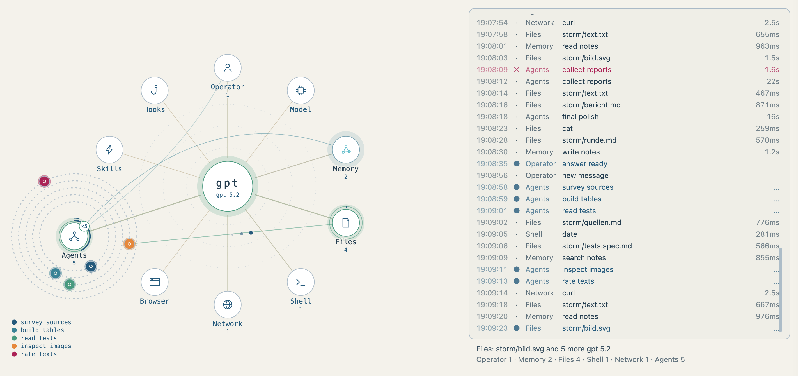

# Agentic Orbit

You ever wondered what your multiagent setup is doing in the background?

A live map of GitHub Copilot's work: tool calls, model steps and agents pulse from the centre to their stations. It runs as a browser app on your machine, beside any editor.



*Agentic Orbit showing a map and call log in the Fraunhofer light theme.*

Inspired from [lot-map](https://github.com/alexeyw/lot-map) by Aleksei Volodin.

## Run the map

Watch a real Copilot session in a browser window of its own. Agentic Orbit runs beside the project: it adds no dependency to it, reads only the events file its workspace hook writes, and binds to your machine only.

### 1. Install the workspace hooks (once per project)

Starting the host does **not** install hooks. Install them first — this writes `.github/hooks/` into the project and exits:

```bash
cd app
npm install
npm run build
npm start -- --install-hooks /absolute/path/to/the/project
```

If the project already has `.github/hooks/hooks.json`, back it up first: the installer overwrites that file. Start a new Copilot session afterwards so it loads the hooks. The app ships no guard: a project's own `preToolUse` hook can deny a call and report it, which lights the Hooks station; see [Hooks for your project](docs/hooks.md#guards).

### 2. Watch the project

```bash
npm start -- --workspace /absolute/path/to/the/project
```

Open <http://127.0.0.1:8318>. Pass the project path absolutely so the host and the hook agree on the events file. Without installed hooks the map stays empty; the host never writes into the project. To watch an events file directly instead, use `--events-file <path>`; see the [App guide](docs/app.md) for that and all other options.

The app does not require our hook script: any producer that appends the event lines works. [Hooks for your project](docs/hooks.md) shows the format, a manifest, a minimal adapter and how to test the feed.

Copilot is the one producer with a ready-made observer today: the map reads the events its workspace hook writes. The event format is host-neutral, so another agent host can feed the same map through its own adapter; no such adapter ships yet.

- Keep the map full-size on a second screen or shared display.
- See every call in a console-style log, with timestamp, station, label and duration.
- Tune palette, layout, motion, pace, language and log size while the session runs.

See the [App guide](docs/app.md) for all options and details.

## Learn more

- [User guide: stations, map, hooks and settings](docs/usage.md)
- [Hooks for your project: the event format and a minimal adapter](docs/hooks.md)
- [Browser app guide](docs/app.md)
- [Development and visual previews](docs/development.md)
- [Privacy](PRIVACY.md)
- [Changelog](CHANGELOG.md)
- [Contributing](CONTRIBUTING.md)

## License

[MIT](LICENSE)
